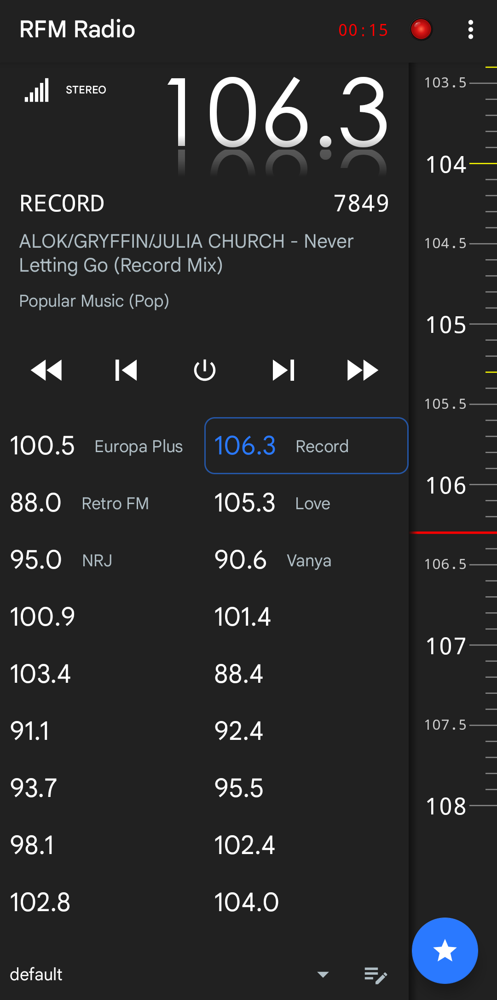
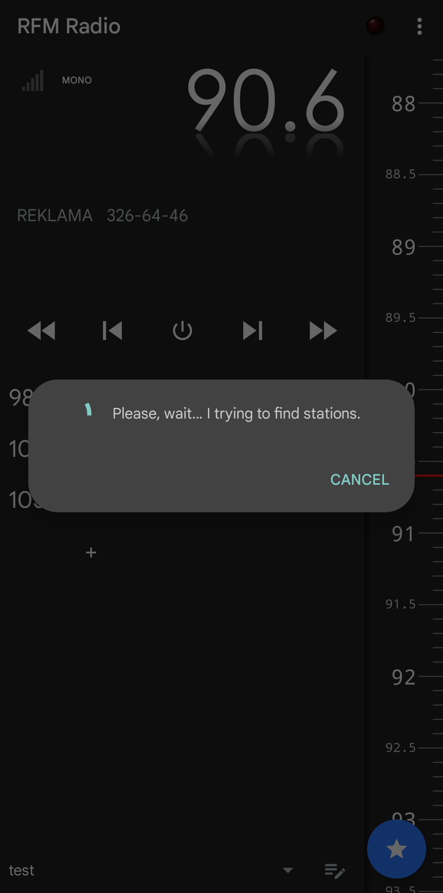
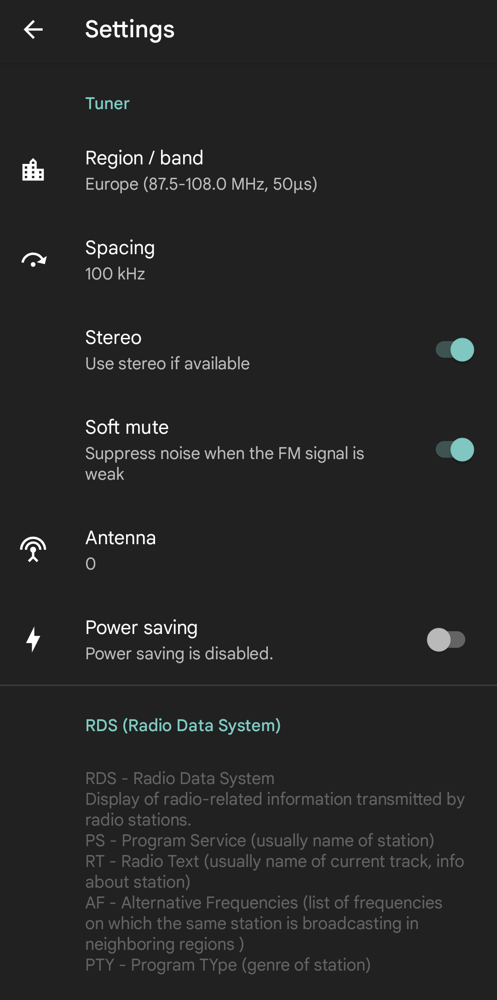

# Real FM Radio [](https://github.com/vladislav805/RFM-Radio/releases/latest)

Real FM hardware radio app for Android Qualcomm Snapdragon based devices.

[](https://apt.izzysoft.de/fdroid/index/apk/com.vlad805.fmradio)

## Requirements

- Android 6.0+ (SDK 23+).
- Root access is required, especially on AOSP-based ROMs.

## Features

- Live FM playback using supported hardware backend.
- RDS metadata: PS, RT, PTY.
- Recording to `.wav` and `.mp3`, with a matching `.srt` file containing frequency, PI, PS and RT.
- Favorites (presets) with custom names.
- Multiple favorite lists.
- Favorite list manager screen with import/export.

## Favorites UX

- Main screen: tune quickly, reorder presets, switch active favorite list.
- Favorite Lists screen: manage lists (create, rename, remove, import, export).

## Settings highlights

### Tuner

#### Enable RDS

RDS is a radio data system.
When this option **is enabled**, the application will display data transmitted from the radio station, such as the Program Service and Radio Text.

#### Antenna

Select an antenna. In most cases: 0 - default, headphones; 1 - internal (bad quality).

### Application
#### Autostart

If enabled, audio from the radio will be immediately turned on after starting the application.


### Notifications
#### Show PS in title

If the option is enabled, then with the "Enable RDS" option enabled, the Program Service and Radio Text will be displayed in the notification header.


## Screenshots



## Building

Clone the repository with submodules, or initialize them before building:

```bash
git clone --recursive https://github.com/vladislav805/RFM-Radio.git
```

For an existing checkout:

```bash
git submodule update --init --recursive
```

```bash
./gradlew :app:assembleDebug
```

Use `make build-debug` for a debug APK or `make build-release` for a release APK.
Release signing uses the `ANDROID_RELEASE_*` environment variables described below;
without signing credentials, the release APK is unsigned.

Gradle builds the app native MP3 encoder and FM backend assets automatically. For native/FM backend-related work you also need Android NDK headers and device-specific tooling.

Run Java unit tests with `make test-java` and native host tests with
`make test-native`.

## RDS recording subtitles

The **Save RDS as subtitles** option in recording settings is disabled by
default. When enabled, each MP3/WAV recording is accompanied by a UTF-8 SRT file
with the same basename in the same folder. Changes apply to new recordings;
disabling the option leaves existing SRT files untouched. Each cue shows the
frequency and four-digit hexadecimal PI, followed by PS and RT.
An unknown PI is written as `0000`; unavailable PS/RT are shown as `—`. ECC is not recorded.

Subtitle times follow captured PCM, including the available pre-roll history.
They indicate when RDS updates were received, which can differ from the timing
of the broadcast audio. Deleting a recording through its notification also
removes its SRT file. If saving subtitles fails, the audio is preserved and the
app shows a warning. Automatic SRT loading for audio depends on the player.

Android 10 requires storage permission when SRT saving is enabled. Android 9
and older require it for audio as well. Android 11+ publishes both files through
MediaStore.

## GitHub Actions

Pull requests and pushes to `master` run native host tests, build a debug APK,
and run Android unit tests. APKs and unit test reports are available as workflow
artifacts.

Pushing a `vMAJOR.MINOR.PATCH` tag or manually running **Android Build** with a
version builds a release APK and creates a draft GitHub release containing the
APK. The requested version must match the APK version from
`app/build.gradle`; the workflow does not change the app version.

Release signing uses the repository secrets `ANDROID_RELEASE_KEYSTORE_BASE64`,
`ANDROID_RELEASE_STORE_PASSWORD`, `ANDROID_RELEASE_KEY_ALIAS`, and
`ANDROID_RELEASE_KEY_PASSWORD`. Without signing credentials, the release APK is
unsigned. The keystore is removed after the build.

Dependabot checks GitHub Actions updates monthly.

## Inspired by

> Spirit1 and Spirit2 by Mike Reid.
>
> R.I.P. 2016

## Disclaimer

The project is based on hard-to-piece collected documentation around Tavarua, Iris, I2C, V4L2.

## Contributors

- Vladislav Veluga ([@vladislav805](https://github.com/vladislav805)) — developer
- Mike Reid ([@mikereidis](https://github.com/mikereidis)) — developer of Spirit 1/2
- Konstantin Manaev ([@SoSlowMan](https://github.com/SoSlowMan)) — translator (English)
- Andus ([@AndusDEV](https://github.com/AndusDEV)) — translator (Polish)

## Star History

<a href="https://www.star-history.com/?repos=vladislav805%2Frfm-radio&type=date&legend=top-left">
 <picture>
   <source media="(prefers-color-scheme: dark)" srcset="https://api.star-history.com/chart?repos=vladislav805/rfm-radio&type=date&theme=dark&legend=top-left" />
   <source media="(prefers-color-scheme: light)" srcset="https://api.star-history.com/chart?repos=vladislav805/rfm-radio&type=date&legend=top-left" />
   
 </picture>
</a>
